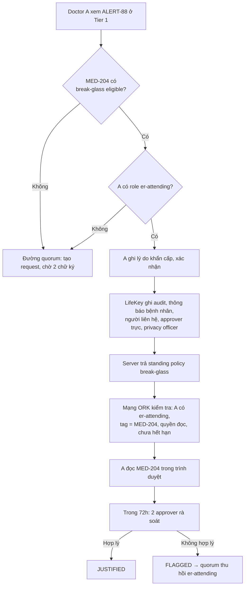

# LifeKey: Emergency Medical Passport (v2)

> **Trạng thái:** kiến trúc đã đối chiếu với mã nguồn TideCloak/ORK (10/2026); có bản thử chạy được trong repo này (`docs/RUNBOOK.md`). Còn 3 điểm phải xác nhận khi chạy live (mục 6.3).
> **Chỉ dùng dữ liệu y tế giả lập.** Không dùng cho chăm sóc bệnh nhân thật.

## 0. Pitch

**Một dòng:** *LifeKey cho bác sĩ cấp cứu thấy ngay cảnh báo sống còn. Hồ sơ chi tiết chỉ mở cho đúng một bác sĩ, đúng một hồ sơ, trong thời hạn ngắn, và ngay cả admin hay server bị hack cũng không tự mở được.*

### Vì sao phải là Tide

| Hệ thống thường (RBAC + mã hoá DB) | LifeKey trên Tide |
|---|---|
| Server giữ khoá → server bị hack là lộ hết | Server chỉ có ciphertext. Khoá phân tán trên mạng ORK; không nơi nào giữ đủ khoá |
| Admin/DBA sửa một dòng là tự cấp quyền | Mỗi quyền đọc là một **policy** chỉ có hiệu lực khi **quorum admin ký**. Server không ký được |
| "Ai được đọc" kiểm tra trong code app | Mạng ORK kiểm tra **trên mỗi lần giải mã**: đúng người (Tide key), đúng record (tag), đúng thao tác, chưa hết hạn |

Ba câu để nói với giám khảo:
1. **Hack server LifeKey → chỉ lấy được ciphertext.**
2. **Không một người nào, kể cả admin, tự mở được hồ sơ.**
3. **Grant cho bác sĩ A dùng cho MED-204 thì không mở được MED-205, không dùng được cho người khác (kể cả chính bệnh nhân), và tự hết hạn.** Trang `/proof` chứng minh điều này trực tiếp trên mạng Tide.

## 1. Vấn đề và giới hạn thừa nhận

- Người **chưa có hồ sơ** trong LifeKey hoặc bệnh viện tích hợp: không có phép màu nào lấy được lịch sử. LifeKey hiện *"No previous medical records available"* và không suy đoán.
- Bệnh nhân bất tỉnh không đồng ý được. Quyền cấp cứu dựa trên **đồng ý trước** (lúc enrollment) hoặc căn cứ pháp lý/quy định bệnh viện. Chữ ký của nhân viên y tế **không tạo ra** sự đồng ý của bệnh nhân.
- Phân quyền **không được làm chậm xử trí**: xem mục 2 và 3.

## 2. Ba đường truy cập, theo độ khẩn

Đây là câu trả lời cho câu hỏi *"3 giờ sáng thì tìm B và C ở đâu?"*: **không phải lúc nào cũng cần B và C.**

| Đường | Ai | Thời gian tới dữ liệu | Ai đã phê duyệt, khi nào | Cơ chế Tide |
|---|---|---|---|---|
| **Tier 0** (tuỳ chọn) | Bất kỳ ai cầm thẻ/màn hình khoá | 0 giây, không đăng nhập | Bệnh nhân tự chọn nội dung | Không mã hoá, tương đương Medical ID |
| **Tier 1**: Critical Summary | Bác sĩ đã xác minh (`lifekey-clinician`) | Thời gian đăng nhập | Quorum ký **một lần lúc enrollment** | Standing policy, subject = Role |
| **Tier 2 break-glass** | ER attending trực (`er-attending`) | Vài giây (ghi lý do) | Bệnh nhân cho phép trước + quorum ký lúc enrollment; **2 người rà soát sau** | Standing policy, subject = Role, chỉ các record bệnh nhân đánh dấu |
| **Tier 2 quorum** | Đúng 1 bác sĩ | Vài phút (chờ 2 chữ ký) | 2 approver, **tại thời điểm yêu cầu** | Policy riêng: User + record + hết hạn |
| **Tier 3** | Không mở qua luồng cấp cứu | — | Căn cứ pháp lý riêng | Grant Tier 2 không bao giờ mở được Tier 3 |

> **Quorum dùng cho truy cập thông thường; break-glass dùng khi khẩn cấp thật.** Break-glass không bỏ quorum, mà **dời quorum lên trước**: lúc enrollment, bệnh nhân và hội đồng duyệt quyết định hồ sơ nào được mở theo cách này, cho vai trò nào.

## 3. Break-glass

### 3.1 Luồng



### 3.2 Cái gì do mạng Tide thực thi, cái gì do app

Bảng này cần trung thực trước giám khảo:

| Kiểm soát | Thực thi bởi | Ghi chú |
|---|---|---|
| Chỉ người có `er-attending` đọc được | **Mạng ORK** | Role được cấp qua change request có quorum |
| Chỉ các record bệnh nhân cho phép | **Mạng ORK** | Mỗi record một policy riêng; không có policy cho MED-205 hay PSY-301 |
| Không bao giờ mở Tier 3 | **Mạng ORK** + quy tắc enrollment | `validateGrant` từ chối tạo policy break-glass cho Tier 3 |
| Policy tự hết hạn (30 ngày) và phải ký lại | **Mạng ORK** | Expiry được ký trong policy (policy v4) |
| Bắt buộc lý do, thông báo, giới hạn 3 lần/24h | App LifeKey | Server chỉ trả policy sau khi khai báo |
| Rà soát bởi 2 người khác bác sĩ đó | App LifeKey | Kết luận "không hợp lý" → đề xuất thu hồi role (qua quorum) |
| Audit chuỗi hash | App LifeKey | Phát hiện sửa/xoá, nhưng không chống được người kiểm soát server viết lại toàn bộ chuỗi |

**Giới hạn đã biết (đã đưa vào `/proof`, phép thử A7):** policy không phải bí mật. Một `er-attending` đã có policy bytes thì có thể giải mã MED-204 mà **không khai báo** qua LifeKey. Mạng vẫn chặn mọi người không có role và mọi record khác, nhưng *lý do và thông báo* chỉ được đảm bảo ở tầng app.
Hướng nâng cấp: (a) expiry ngắn hơn và ký lại định kỳ; (b) một Forseti contract riêng yêu cầu bằng chứng khai báo, kiểu `ValidateData` kiểm tra một attestation "break-glass declared" (contract tuỳ chỉnh do Tide team deploy, nên để sau hackathon); (c) đối chiếu log giải mã phía ORK nếu Tide cung cấp.

### 3.3 Slide "Quorum vs Break-glass"

| | Quorum (thường ngày) | Break-glass (khẩn cấp thật) |
|---|---|---|
| Khi nào | Bệnh nhân ổn định, cần xem thêm hồ sơ | Bất tỉnh, chảy máu, không chờ được |
| Ai duyệt | 2 approver, **trước** khi đọc | Bệnh nhân + quorum **từ lúc enrollment**; 2 người **rà soát sau** |
| Phạm vi | Đúng 1 bác sĩ, 1 hồ sơ, 2 giờ | Role `er-attending`, chỉ hồ sơ bệnh nhân đánh dấu, không bao giờ Tier 3 |
| Mạng Tide kiểm tra | Tide key của bác sĩ, tag record, hết hạn | Role, tag record, hết hạn |
| Hậu quả lạm dụng | Không có quyền thì không đọc được | Bị gắn cờ, quorum thu hồi role |

## 4. Tier 1: cảnh báo phải cụ thể

v1 có mâu thuẫn: bảng ghi Tier 1 chứa "thuốc nguy cơ cao", nhưng ví dụ lại là *"Có thông tin thuốc cần kiểm tra…"*. v2 sửa theo quy tắc sau:

- **Tier 1 nói thẳng thông tin cần để hành động**: tên thuốc, liều, dị ứng, thiết bị cấy ghép.
- **Chỉ được khái quát hoá khi nguồn là Tier 3** và bệnh nhân chọn không nêu tên.
- Mỗi cảnh báo có `source_record_id`, trạng thái xác minh, người và thời điểm xác minh.

```json
{
  "alert_id": "ALERT-88",
  "source_record_id": "MED-204",
  "category": "high_risk_medication",
  "message": "Đang dùng warfarin 5 mg/ngày (chống đông). Nguy cơ chảy máu: kiểm tra INR trước thủ thuật.",
  "context_tags": ["trauma", "surgery", "bleeding"],
  "verification_status": "clinician_verified",
  "verified_at": "2026-10-20T10:00:00Z"
}
```

Ví dụ khái quát hoá hợp lệ (nguồn Tier 3): *"Có hồ sơ hạn chế liên quan đến tương tác thuốc an thần. Cân nhắc trước khi dùng benzodiazepine."*

Màn hình Tier 1 luôn phân biệt **đã xác minh**, **bệnh nhân tự khai**, **chưa xác minh** và **chưa có dữ liệu**. "Chưa có dữ liệu" không có nghĩa là không có nguy cơ.

Khi đã có Tier 1 cụ thể, Tier 2 chỉ cần khi bác sĩ muốn **chi tiết** (lịch sử INR, toàn bộ danh sách thuốc), không cần cho quyết định đầu tiên.

## 5. "Bác sĩ đã xác thực" là ai

| Bước | Làm gì | Ai/cơ chế |
|---|---|---|
| Danh tính | Đăng nhập Tide (BYOiD): không mật khẩu nào nằm trên server | Tide |
| Xác minh hành nghề | Bệnh viện đối chiếu chứng chỉ hành nghề (ở VN: CCHN / tra cứu cơ quan quản lý) | Phòng nhân sự/khoa |
| Cấp `lifekey-clinician` | Change request trong TideCloak, **quorum duyệt** | QEA |
| Cấp `er-attending` | Theo lịch trực khoa cấp cứu, cũng qua quorum | QEA |
| Nghỉ việc / chuyển khoa | Thu hồi role (change request); policy theo Role mất hiệu lực ở lần đăng nhập/refresh token kế tiếp | QEA |

**Nhân viên cứu thương ngoài hiện trường / bệnh viện chưa tích hợp:**
- Thấy **Tier 0** (thẻ ví hoặc màn hình khoá, bệnh nhân tự chọn), giống Medical ID.
- Nếu tổ chức của họ onboard vào realm thì được role `lifekey-responder` với một standing policy Tier 1 riêng (chưa có trong bản thử).
- Họ **không** thấy Tier 1 nếu không được xác minh. Đó là đánh đổi có chủ đích: Tier 1 có tên thuốc và bệnh lý.

So với Medical ID: Tier 0 của LifeKey *chính là* Medical ID. LifeKey thêm phần Medical ID không có: thông tin đã được bác sĩ xác minh, có nguồn, có audit, và đường mở hồ sơ chi tiết có kiểm soát.

## 6. Tích hợp Tide: đã kiểm chứng gì

### 6.1 Cơ chế dùng

| Thành phần | Cách dùng trong LifeKey |
|---|---|
| **`RelationshipAttestation:1`** (contract có sẵn trong ORK, không phải viết C#) | Mỗi grant = 1 policy: `subjectType` (User/Role) + `subjectId` + `assignmentId` (= record id) + `roles` (`_tide_decryptor` đọc / `_tide_encryptor` ghi). Mỗi ciphertext chỉ có **một tag = record id** |
| **`POST /admin/realms/{realm}/iga/jit-policies`** với policy dựng sẵn | Tạo change request `SIGN_JIT_POLICY`. Policy **chưa tồn tại** cho tới khi quorum admin duyệt. Lúc commit, TideCloak ký Policy:1 bằng chữ ký các admin rồi lưu vào `/iga/role-policies/name/{name}` |
| **Duyệt** | Từ trình duyệt của approver, bằng token của chính họ: `POST /iga/change-requests/{id}/approve` → ký `requestModel` trong Tide enclave → POST lại |
| **Giải mã** | `IAMService.doDecrypt([{ encrypted, tags: [recordId] }], signedPolicy)` trong trình duyệt bác sĩ |

### 6.2 Dữ kiện đã kiểm chứng từ mã nguồn

| Dữ kiện | Nguồn |
|---|---|
| Contract kiểm tra: đúng subject (Tide key / group / role), tag = `assignmentId` và chỉ 1 tag, policy cho phép thao tác, người gọi có `_tide_decryptor`/`_tide_encryptor`, chưa hết hạn | `raziel-mcp/reference-apps/relationship-attestation/scenario.md` (đối chiếu ORK `main` @ `c69fc4f6`, 2026-10-16, đã đo end-to-end) |
| `jit-policies` nhận policy dựng sẵn ("any well-formed policy for this realm"), trả 202, chỉ ký khi quorum duyệt | `tidecloak-iga-extensions/iga-core/.../IgaAdminResource.java` `requestJitPolicy`, `TideAttestor.replaySignJitPolicy` |
| Ngưỡng = `max(1, floor(0.7 × số tide-realm-admin))` → **2 admin chỉ cần 1 chữ ký; cần ≥ 3 admin để bắt buộc 2 chữ ký** | `canon/iga-change-requests-api.md`, docs.tide.org Quorum Enforced Governance |
| **Không có luật "người tạo request không được tự duyệt"** trong iga-core | `canon/iga-change-requests-api.md` (status 409) |
| Approval được ghi cho **người gọi HTTP**, nên duyệt qua proxy server thì mọi chữ ký gộp thành 1 phiếu | như trên |
| Policy v4 có expiry được ký; mạng từ chối policy hết hạn trước khi chạy contract | Release notes TideCloak 0.14.28 |
| Approver cần `manage-realm` (endpoint `approve` gọi `requireManageRealm`) + `tide-realm-admin` | `IgaAdminResource.approve` |

Hệ quả thiết kế:
- **Doctor A không bao giờ là tide-realm-admin**: đây là cách duy nhất chặn tự duyệt ở tầng Tide. LifeKey chặn thêm ở tầng app (`canApprove`, và approver không được tạo request).
- Demo cần **3 approver** (records officer, B, C), ngưỡng 2-of-3. Nói rõ là "2 trong 3", không phải "B và C bắt buộc".
- Thu hồi một grant `User` trước hạn: **không có tức thì**. Dùng hạn ngắn (mặc định 2h, tối đa 4h). Muốn cắt ngay một bác sĩ thì thu hồi role `_tide_decryptor` (mất quyền với *mọi* record).

### 6.3 Còn phải xác nhận khi chạy live

1. Mạng mà `tideorg/tidecloak-dev` dùng đã có `RelationshipAttestation:1` (ORK build từ 16/10/2026). Nếu chưa có, hỏi Tide team, **không** tự viết contract thay.
2. TideCloak giải mã (`Policy.From`) rồi mã hoá lại (`ToBytes`) policy do JS dựng mà ra đúng các byte đó. LifeKey xếp param theo thứ tự khoá đã sort để giảm rủi ro; trang `/setup` báo `FAILED` nếu policy đã ký khác với cái đã gửi.
3. Role voucher: bản thử cấp thêm `_tide_x.selfdecrypt` / `_tide_x.selfencrypt` phòng trường hợp voucher của ORK chưa nhận `_tide_decryptor`.

## 7. So sánh

| | Apple/Android Medical ID | International Patient Summary (IPS, HL7 FHIR) | EHR có break-the-glass (Epic, Cerner…) | Care Passport | **LifeKey** |
|---|---|---|---|---|---|
| Xem không cần đăng nhập | ✅ | — (định dạng, không phải app) | ❌ | ? | ✅ Tier 0 |
| Thông tin đã được bác sĩ xác minh, có nguồn | ❌ bệnh nhân tự nhập | ✅ | ✅ | ? | ✅ |
| Truy cập tăng dần theo độ khẩn | ❌ | ❌ | Một phần | ❌ | ✅ Tier 0 → 1 → break-glass/quorum |
| Break-glass | — | — | ✅ nhưng chỉ ở tầng app, admin EHR vượt được | ? | ✅ role và record do mạng thực thi |
| Server/admin bị chiếm vẫn không lộ hồ sơ | — (lưu trên máy) | phụ thuộc nơi lưu | ❌ | ? | ✅ |
| Grant đúng người + đúng record + có hạn, kiểm tra ngoài server | ❌ | ❌ | ❌ | ? | ✅ |

IPS là **định dạng** nên dùng cho Tier 1 khi tích hợp thật (`Patient`, `AllergyIntolerance`, `MedicationStatement`, `Flag`). LifeKey không cạnh tranh với IPS mà bọc IPS bằng lớp phân quyền mạng.

## 8. Demo (3 phút)

Mở sẵn 5 browser profile: admin, A, B, C, D.

1. **(20s) Vì sao Tide:** mở `data/lifekey-store.json`: chỉ có ciphertext.
2. **(30s) Tier 1:** A quét QR → thấy ngay *warfarin 5 mg/ngày*, dị ứng penicillin, van tim cơ học.
3. **(40s) Quorum:** A bấm *View source record* trên ALERT-88 → REQ-1042 cho MED-204. A thử giải mã: bị từ chối. B duyệt → `1/2`, A vẫn bị từ chối. C duyệt → `COMMITTED`. A giải mã được MED-204.
4. **(30s) Phạm vi:** `/proof` với A: A2 (MED-205), A3 (Tier 3), A5 (ghi đè) đều bị **mạng Tide** từ chối, kèm thông báo của contract.
5. **(20s) Người khác:** `/proof` với bệnh nhân: P1, dùng grant bị lộ của A → *subjectId does not match*.
6. **(30s) Break-glass:** "Giờ là 3 giờ sáng." A bấm Break glass, ghi lý do, đọc MED-204 ngay. B thấy trong hàng chờ rà soát.
7. **(10s) Server không duyệt hộ được:** `/proof` S1.

## 9. Security test cases (khớp với `/proof`)

| ID | Ai | Phép thử | Mong đợi | Ai chặn |
|---|---|---|---|---|
| A1 | A | Đọc MED-204 bằng grant của chính A | Cho phép | — |
| A2 | A | Grant MED-204 → đọc MED-205 | Từ chối | ORK (tag) |
| A3 | A | Grant MED-204 → đọc Tier 3 | Từ chối | ORK (tag) |
| A4 | A | Gắn tag MED-204 lên ciphertext MED-205 | Từ chối | ORK (khoá theo tag) |
| A5 | A | Ghi bằng grant chỉ-đọc | Từ chối | ORK (`roles`) |
| A6 | A | Policy Tier 1 → đọc MED-204 | Từ chối | ORK (tag) |
| A7 | A | Policy break-glass không khai báo | **Cho phép** (giới hạn đã biết) | — |
| A8 | A | Đọc Tier 1 | Cho phép | — |
| P1 | Bệnh nhân | Dùng grant của A | Từ chối | ORK (subject) |
| P2 | Bệnh nhân | Break-glass khi không phải er-attending | Từ chối | ORK (role) |
| P3 | Bệnh nhân | Dùng policy Tier 1 của bác sĩ để đọc bản tóm tắt của mình | Từ chối | ORK (role) |
| R1 | admin | Records officer đọc lại hồ sơ đã ghi | Từ chối | ORK (`roles` chỉ ghi) |
| B1 | B, C | Approver đọc Tier 1 | Từ chối | ORK (không có role) |
| S1 | bất kỳ | Server master-admin tự duyệt CR | Không được ghi nhận | TideCloak (cần enclave) |
| — | B một mình | Chỉ 1 chữ ký | Policy chưa tồn tại | TideCloak quorum |
| — | A | Sửa request sau khi gửi | `FAILED_VALIDATION` | LifeKey (digest + so policy đã ký) |
| — | A | Hết hạn | Từ chối giải mã mới | ORK (expiry) |
| — | A | Tự duyệt | Không thể | A không phải admin + `canApprove` |

Giới hạn thu hồi: plaintext đã xem, chụp hoặc tải xuống thì không thu hồi được.

## 10. Kiến trúc và repo

| Thành phần | Ở đâu |
|---|---|
| Next.js 16 + `@tidecloak/nextjs` (DPoP strict) | `src/app` |
| Quy tắc grant (Tier, break-glass, JIT) | `src/lib/lifekey/grants.ts` |
| Request bất biến (digest, đối chiếu policy đã ký) | `src/lib/lifekey/requests.ts` |
| Break-glass + rà soát | `src/lib/lifekey/breakglass.ts` |
| Audit chuỗi hash | `src/lib/lifekey/audit.ts` |
| Dựng/đọc policy `RelationshipAttestation:1` | `src/lib/tide/policyBytes.ts` |
| Gọi IGA (file CR, đọc policy đã ký) | `src/lib/tide/igaServer.ts` |
| Duyệt từ trình duyệt approver | `src/lib/client/approve.ts` |
| Giải mã/mã hoá theo record | `src/lib/tide/relationship.ts` (template của Tide) |
| Store (JSON, chỉ ciphertext + metadata) | `data/lifekey-store.json` (thay bằng Postgres sau) |
| Unit test luật nghiệp vụ | `npm test` (12 test) |

## 11. Việc còn lại

- [ ] Chạy `docs/RUNBOOK.md` end-to-end trên TideCloak thật; chụp kết quả `/proof`.
- [ ] Xác nhận 3 điểm ở 6.3.
- [ ] QR thật (`qrcode`) + Tier 0 trên thẻ.
- [ ] Stretch: IPS/FHIR cho Tier 1, `lifekey-responder`, Forseti contract cho break-glass.
- [ ] Đồng ý của bệnh nhân hiện do **app** kiểm soát (`src/lib/lifekey/consent.ts`, trang `/me`): LifeKey chỉ gửi quyền bệnh nhân đã ký và từ chối mở khẩn cấp khi bệnh nhân đã rút. Để **mạng** đòi chữ ký bệnh nhân cần một Forseti contract riêng (ví dụ kiểm tra attestation "patient consented" trước khi ký policy); contract tuỳ chỉnh do Tide team deploy.
- [ ] Bệnh nhân rút đồng ý: LifeKey ngừng phát policy ngay, nhưng policy break-glass đã ký vẫn hợp lệ trên mạng tới khi hết hạn (30 ngày). Cân nhắc hạn ngắn hơn cho standing grant.
- [ ] Bệnh nhân chưa tự đọc được hồ sơ của mình (không có policy nào cho tài khoản bệnh nhân). Thêm grant `User` = khoá Tide của bệnh nhân nếu cần.
- [ ] Tài khoản bệnh nhân gắn với bệnh nhân bằng `PATIENT_ACCOUNTS` trong `catalogue.ts`; bản thật cần bước xác minh danh tính khi đăng ký.

## 12. Tham khảo

- TideCloak docs: https://docs.tide.org/ · Forseti: https://docs.tide.org/Core-Concepts/forseti-engine · QEA: https://docs.tide.org/Core-Concepts/iga-workflow · E2EE: https://docs.tide.org/Admin/e2ee
- Release notes JIT policy: https://docs.tide.org/ReleaseNotes/Tidecloak-0.14.28
- `RelationshipAttestation:1`: https://github.com/tide-foundation/raziel-mcp (`reference-apps/relationship-attestation`, `templates/relationship-attestation`)
- IGA API (jit-policies, approve): https://github.com/tide-foundation/tidecloak-iga-extensions
- HL7 FHIR IPS: https://hl7.org/fhir/uv/ips/ · Flag: https://hl7.org/fhir/flag.html
