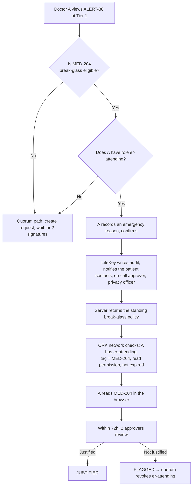

# LifeKey: Emergency Medical Passport (v2)

> **Status:** architecture checked against the TideCloak/ORK source code (Oct 2026); a working prototype is in this repo (`docs/RUNBOOK.md`); the UI is in English. Three points still need confirming on a live run (section 6.3).
> **Synthetic medical data only.** Not for real patient care.

## 0. Pitch

**One line:** *LifeKey shows emergency doctors the life-critical alerts at once. Detailed records open only for one doctor, one record, for a short time, and not even an admin or a hacked server can open them alone.*

### Why it has to be Tide

| Typical system (RBAC + DB encryption) | LifeKey on Tide |
|---|---|
| The server holds the keys → hack the server and everything leaks | The server holds only ciphertext. Keys are distributed across the ORK network; no single place holds a whole key |
| An admin/DBA edits one row and grants themselves access | Every read grant is a **policy** that takes effect only once a **quorum of admins signs** it. The server cannot sign |
| "Who may read" is checked in app code | The ORK network checks **on every decryption**: right person (Tide key), right record (tag), right operation, not expired |

Three sentences for the judges:
1. **Hack the LifeKey server → you only get ciphertext.**
2. **No single person, admin included, can open a record alone.**
3. **A grant for Doctor A on MED-204 cannot open MED-205, cannot be used by anyone else (including the approver who signed it), and expires on its own.** The `/proof` page demonstrates this directly against the Tide network.

## 1. The problem and acknowledged limits

- For someone with **no record** in LifeKey or an integrated hospital, nothing can conjure up a history. LifeKey shows *"No previous medical records available"* and does not guess.
- An unconscious patient cannot consent. Emergency access rests on **prior consent** (given at enrollment) or on a legal basis/hospital policy. A clinician's signature **does not create** patient consent.
- Access control **must not delay treatment**: see sections 2 and 3.

## 2. Three access paths, by urgency

This is the answer to *"At 3 a.m., where do you find B and C?"*: **you don't always need B and C.**

| Path | Who | Time to data | Who approved, and when | Tide mechanism |
|---|---|---|---|---|
| **Tier 0** (optional) | Anyone holding the card / lock screen | 0 seconds, no login | The patient chooses the content | Not encrypted, equivalent to Medical ID |
| **Tier 1**: Critical Summary | Verified clinician (`lifekey-clinician`) | Login time | Quorum signs **once at enrollment** | Standing policy, subject = Role |
| **Tier 2 break-glass** | On-duty ER attending (`er-attending`) | A few seconds (reason recorded) | Patient's prior permission + quorum signature at enrollment; **2 reviewers afterwards** | Standing policy, subject = Role, only records the patient marked |
| **Tier 2 quorum** | Exactly 1 doctor | A few minutes (waiting for 2 signatures) | 2 approvers, **at the time of the request** | Dedicated policy: User + record + expiry |
| **Tier 3** | Not opened through the emergency flow | — | Separate legal basis | A Tier 2 grant can never open Tier 3 |

> **Quorum is for routine access; break-glass is for real emergencies.** Break-glass does not skip the quorum, it **moves the quorum earlier**: at enrollment, the patient and the approval board decide which records can be opened this way, and for which role.

## 3. Break-glass

### 3.1 Flow



### 3.2 What the Tide network enforces and what the app enforces

This table has to be honest in front of the judges:

| Control | Enforced by | Notes |
|---|---|---|
| Only holders of `er-attending` can read | **ORK network** | The role is granted through a quorum-approved change request |
| Only records the patient allowed | **ORK network** | One policy per record; there is no policy for MED-205 or PSY-301 |
| Tier 3 is never opened | **ORK network** + enrollment rule | `validateGrant` refuses to create a break-glass policy for Tier 3 |
| Policy expires on its own (30 days) and must be re-signed | **ORK network** | The expiry is signed into the policy (policy v4) |
| Mandatory reason, notifications, limit of 3 uses per 24h | LifeKey app | The server returns the policy only after the declaration |
| Review by 2 people other than that doctor | LifeKey app | A "not justified" verdict → proposal to revoke the role (via quorum) |
| Hash-chained audit | LifeKey app | Detects edits/deletions, but cannot stop someone who controls the server from rewriting the whole chain |

**Known limit (included in `/proof`, check A7):** a policy is not a secret. An `er-attending` who already has the policy bytes can decrypt MED-204 **without declaring** through LifeKey. The network still blocks everyone without the role and every other record, but the *reason and notifications* are only guaranteed at the app layer.
Upgrade paths: (a) shorter expiry and periodic re-signing; (b) a dedicated Forseti contract that requires proof of declaration, e.g. a `ValidateData` that checks a "break-glass declared" attestation (custom contracts are deployed by the Tide team, so this waits until after the hackathon); (c) reconciling against ORK-side decryption logs if Tide provides them.

### 3.3 "Quorum vs Break-glass" slide

| | Quorum (routine) | Break-glass (real emergency) |
|---|---|---|
| When | Patient is stable, more of the record is needed | Unconscious, bleeding, cannot wait |
| Who approves | 2 approvers, **before** reading | Patient + quorum **at enrollment**; 2 people **review afterwards** |
| Scope | Exactly 1 doctor, 1 record, 2 hours | Role `er-attending`, only records the patient marked, never Tier 3 |
| Tide network checks | Doctor's Tide key, record tag, expiry | Role, record tag, expiry |
| Consequence of abuse | No grant, no read | Flagged, quorum revokes the role |

## 4. Tier 1: alerts must be specific

v1 contradicted itself: the table said Tier 1 contains "high-risk medications", but the example read *"There is medication information to check…"*. v2 fixes this with the following rules:

- **Tier 1 states the information needed to act**: drug name, dose, allergies, implanted devices.
- **Generalisation is allowed only when the source is Tier 3** and the patient chose not to name it.
- Every alert has a `source_record_id`, a verification status, and who verified it and when.

```json
{
  "alert_id": "ALERT-88",
  "source_record_id": "MED-204",
  "category": "high_risk_medication",
  "message": "Taking warfarin 5 mg/day (anticoagulant). Bleeding risk: check INR before procedures.",
  "context_tags": ["trauma", "surgery", "bleeding"],
  "verification_status": "clinician_verified",
  "verified_at": "2026-10-20T10:00:00Z"
}
```

A valid generalised example (Tier 3 source): *"There is a restricted record related to sedative interactions. Take care before giving benzodiazepines."*

The Tier 1 screen always distinguishes **verified**, **patient-reported**, **unverified** and **no data yet**. "No data yet" does not mean there is no risk.

With a specific Tier 1 in place, Tier 2 is needed only when the doctor wants **detail** (INR history, the full medication list), not for the first decision.

## 5. Who counts as a "verified clinician"

| Step | What happens | Who/mechanism |
|---|---|---|
| Identity | Tide login (BYOiD): no password is stored on the server | Tide |
| Practice verification | The hospital checks the practising licence (in Vietnam: the CCHN / regulator lookup) | HR / department |
| Grant `lifekey-clinician` | Change request in TideCloak, **quorum-approved** | QEA |
| Grant `er-attending` | Follows the emergency department's duty roster, also via quorum | QEA |
| Leaving / changing department | Revoke the role (change request); Role-based policies stop working at the next login/token refresh | QEA |

**Paramedics in the field / hospitals not yet integrated:**
- See **Tier 0** (wallet card or lock screen, chosen by the patient), like Medical ID.
- If their organisation is onboarded into the realm, they get the `lifekey-responder` role with its own standing Tier 1 policy (not in the prototype yet).
- They do **not** see Tier 1 unless verified. That is a deliberate trade-off: Tier 1 contains drug names and conditions.

Compared with Medical ID: LifeKey's Tier 0 *is* Medical ID. LifeKey adds what Medical ID lacks: clinician-verified information with a source, an audit trail, and a controlled path to the detailed records.

## 6. Tide integration: what has been verified

### 6.1 Mechanisms used

| Component | How LifeKey uses it |
|---|---|
| **`RelationshipAttestation:1`** (a contract already in the ORK, no C# to write) | Each grant = 1 policy: `subjectType` (User/Role) + `subjectId` + `assignmentId` (= record id) + `roles` (`_tide_decryptor` read / `_tide_encryptor` write). Each ciphertext has exactly **one tag = record id** |
| **`POST /admin/realms/{realm}/iga/jit-policies`** with a prebuilt policy | Creates a `SIGN_JIT_POLICY` change request. The policy **does not exist** until the admin quorum approves. On commit, TideCloak signs Policy:1 with the admins' signatures and stores it at `/iga/role-policies/name/{name}` |
| **Approval** | From the approver's browser, with their own token: `POST /iga/change-requests/{id}/approve` → sign the `requestModel` in the Tide enclave → POST back |
| **Decryption** | `IAMService.doDecrypt([{ encrypted, tags: [recordId] }], signedPolicy)` in the doctor's browser |

### 6.2 Facts verified from the source code

| Fact | Source |
|---|---|
| The contract checks: right subject (Tide key / group / role), tag = `assignmentId` and only 1 tag, the policy allows the operation, the caller has `_tide_decryptor`/`_tide_encryptor`, not expired | `raziel-mcp/reference-apps/relationship-attestation/scenario.md` (checked against ORK `main` @ `c69fc4f6`, 2026-10-16, measured end-to-end) |
| `jit-policies` accepts a prebuilt policy ("any well-formed policy for this realm"), returns 202, signs only when the quorum approves | `tidecloak-iga-extensions/iga-core/.../IgaAdminResource.java` `requestJitPolicy`, `TideAttestor.replaySignJitPolicy` |
| Threshold = `max(1, floor(0.7 × number of tide-realm-admins))` → **2 admins need only 1 signature; at least 3 admins are needed to require 2 signatures** | `canon/iga-change-requests-api.md`, docs.tide.org Quorum Enforced Governance |
| **There is no "the request creator cannot approve it" rule** in iga-core | `canon/iga-change-requests-api.md` (status 409) |
| An approval is recorded for **the HTTP caller**, so approving through a server proxy collapses every signature into 1 vote | as above |
| Policy v4 has a signed expiry; the network rejects an expired policy before running the contract | TideCloak 0.14.28 release notes |
| An approver needs `manage-realm` (the `approve` endpoint calls `requireManageRealm`) + `tide-realm-admin` | `IgaAdminResource.approve` |

Design consequences:
- **Doctor A is never a tide-realm-admin**: this is the only way to block self-approval at the Tide layer. LifeKey adds a block at the app layer (`canApprove`, and approvers cannot create requests).
- The demo needs **3 approvers** (records officer, B, C), threshold 2-of-3. Say clearly that it is "2 of 3", not "B and C are both required".
- Revoking a `User` grant before it expires: **not instant**. Use short lifetimes (default 2h, maximum 4h). To cut off a doctor immediately, revoke the `_tide_decryptor` role (loses access to *every* record).

### 6.3 Still to confirm on a live run

1. The network used by `tideorg/tidecloak-dev` already has `RelationshipAttestation:1` (ORK build from 16/10/2026). If not, ask the Tide team; do **not** write a replacement contract.
2. TideCloak decoding (`Policy.From`) and re-encoding (`ToBytes`) a JS-built policy yields exactly the same bytes. LifeKey orders params by sorted key to reduce the risk; the `/setup` page reports `FAILED` if the signed policy differs from what was sent.
3. Voucher roles: the prototype also grants `_tide_x.selfdecrypt` / `_tide_x.selfencrypt` in case the ORK voucher does not yet accept `_tide_decryptor`.

## 7. Comparison

| | Apple/Android Medical ID | International Patient Summary (IPS, HL7 FHIR) | EHR with break-the-glass (Epic, Cerner…) | Care Passport | **LifeKey** |
|---|---|---|---|---|---|
| Viewable without login | ✅ | — (a format, not an app) | ❌ | ? | ✅ Tier 0 |
| Clinician-verified information with a source | ❌ patient-entered | ✅ | ✅ | ? | ✅ |
| Access escalates with urgency | ❌ | ❌ | Partly | ❌ | ✅ Tier 0 → 1 → break-glass/quorum |
| Break-glass | — | — | ✅ but app-layer only, an EHR admin can bypass it | ? | ✅ role and record enforced by the network |
| Records stay safe if the server/admin is compromised | — (stored on device) | depends on where it is stored | ❌ | ? | ✅ |
| Grant bound to the right person + right record + expiry, checked outside the server | ❌ | ❌ | ❌ | ? | ✅ |

IPS is the **format** to use for Tier 1 in a real integration (`Patient`, `AllergyIntolerance`, `MedicationStatement`, `Flag`). LifeKey does not compete with IPS; it wraps IPS in a network-enforced access layer.

## 8. Demo (3 minutes)

Have 5 browser profiles open: admin, A, B, C, D.

1. **(20s) Why Tide:** open `data/lifekey-store.json`: it holds only ciphertext.
2. **(30s) Tier 1:** A scans the QR → immediately sees *warfarin 5 mg/day*, penicillin allergy, mechanical heart valve.
3. **(40s) Quorum:** A clicks *View source record* on ALERT-88 → REQ-1042 for MED-204. A tries to decrypt: denied. B approves → `1/2`, A is still denied. C approves → `COMMITTED`. A can decrypt MED-204.
4. **(30s) Scope:** `/proof` as A: A2 (MED-205), A3 (Tier 3), A5 (overwrite) are all denied by **the Tide network**, with the contract's message.
5. **(20s) Someone else:** `/proof` as B: B2, using the very grant B just signed for A → *subjectId does not match*.
6. **(30s) Break-glass:** "It's now 3 a.m." A clicks Break glass, records a reason, reads MED-204 at once. B sees it in the review queue.
7. **(10s) The server cannot approve on anyone's behalf:** `/proof` S1.

## 9. Security test cases (matching `/proof`)

| ID | Who | Check | Expected | Blocked by |
|---|---|---|---|---|
| A1 | A | Read MED-204 with A's own grant | Allowed | — |
| A2 | A | MED-204 grant → read MED-205 | Denied | ORK (tag) |
| A3 | A | MED-204 grant → read Tier 3 | Denied | ORK (tag) |
| A4 | A | Put the MED-204 tag on the MED-205 ciphertext | Denied | ORK (key per tag) |
| A5 | A | Write with a read-only grant | Denied | ORK (`roles`) |
| A6 | A | Tier 1 policy → read MED-204 | Denied | ORK (tag) |
| A7 | A | Break-glass policy without declaring | **Allowed** (known limit) | — |
| A8 | A | Read Tier 1 | Allowed | — |

| R1 | admin | Records officer reads back a record they wrote | Denied | ORK (`roles` write-only) |
| B1 | B, C | Approver reads Tier 1 | Denied | ORK (no role) |
| B2 | B, C | Use A's grant (the very grant they signed) | Denied | ORK (subject) |
| B3 | B, C | Break-glass without being er-attending | Denied | ORK (role) |
| S1 | anyone | Server master-admin approves a CR by itself | Not recorded | TideCloak (enclave required) |
| — | B alone | Only 1 signature | Policy does not exist yet | TideCloak quorum |
| — | A | Edit a request after submitting | `FAILED_VALIDATION` | LifeKey (digest + comparison with the signed policy) |
| — | A | Expiry | New decryptions denied | ORK (expiry) |
| — | A | Self-approval | Impossible | A is not an admin + `canApprove` |

Revocation limit: plaintext that has already been viewed, screenshotted or downloaded cannot be revoked.

## 10. Architecture and repo

| Component | Where |
|---|---|
| Next.js 16 + `@tidecloak/nextjs` (DPoP strict) | `src/app` |
| Grant rules (Tier, break-glass, JIT) | `src/lib/lifekey/grants.ts` |
| Immutable requests (digest, comparison with the signed policy) | `src/lib/lifekey/requests.ts` |
| Break-glass + review | `src/lib/lifekey/breakglass.ts` |
| Hash-chained audit | `src/lib/lifekey/audit.ts` |
| Building/reading `RelationshipAttestation:1` policies | `src/lib/tide/policyBytes.ts` |
| IGA calls (file CRs, read signed policies) | `src/lib/tide/igaServer.ts` |
| Approving from the approver's browser | `src/lib/client/approve.ts` |
| Per-record decryption/encryption | `src/lib/tide/relationship.ts` (Tide's template) |
| Store (JSON, ciphertext + metadata only) | `data/lifekey-store.json` (to be replaced by Postgres) |
| Unit tests for the business rules | `npm test` (12 tests) |

## 11. Remaining work

- [ ] Run `docs/RUNBOOK.md` end-to-end on a real TideCloak; capture the `/proof` results.
- [ ] Confirm the 3 points in 6.3.
- [ ] Real QR (`qrcode`) + Tier 0 on the card.
- [ ] Stretch: IPS/FHIR for Tier 1, `lifekey-responder`, a Forseti contract for break-glass.
- [ ] Patient consent is currently enforced by the **app** (`src/lib/lifekey/consent.ts`, the `/me` page): LifeKey only files grants the patient has signed and refuses break-glass once the patient has withdrawn. For the **network** to require the patient's signature, a dedicated Forseti contract is needed (e.g. checking a "patient consented" attestation before the policy is signed); custom contracts are deployed by the Tide team.
- [ ] Patient withdraws consent: LifeKey stops issuing the policy immediately, but a break-glass policy that is already signed stays valid on the network until it expires (30 days). Consider a shorter lifetime for standing grants.
- [x] Patients asking to read their own record: a `patient-self` grant (`User` = the patient's Tide key, one record, at most 4 hours), signed by the quorum like a doctor's request and checked by the network at decryption.
- [ ] Approvers' follow-up questions and patients' objections to a break-glass are app data, not conditions the network checks.
- [ ] Patient accounts are linked to patients through `PATIENT_ACCOUNTS` in `catalogue.ts`; a real deployment needs an identity verification step at sign-up.

## 12. References

- TideCloak docs: https://docs.tide.org/ · Forseti: https://docs.tide.org/Core-Concepts/forseti-engine · QEA: https://docs.tide.org/Core-Concepts/iga-workflow · E2EE: https://docs.tide.org/Admin/e2ee
- JIT policy release notes: https://docs.tide.org/ReleaseNotes/Tidecloak-0.14.28
- `RelationshipAttestation:1`: https://github.com/tide-foundation/raziel-mcp (`reference-apps/relationship-attestation`, `templates/relationship-attestation`)
- IGA API (jit-policies, approve): https://github.com/tide-foundation/tidecloak-iga-extensions
- HL7 FHIR IPS: https://hl7.org/fhir/uv/ips/ · Flag: https://hl7.org/fhir/flag.html
